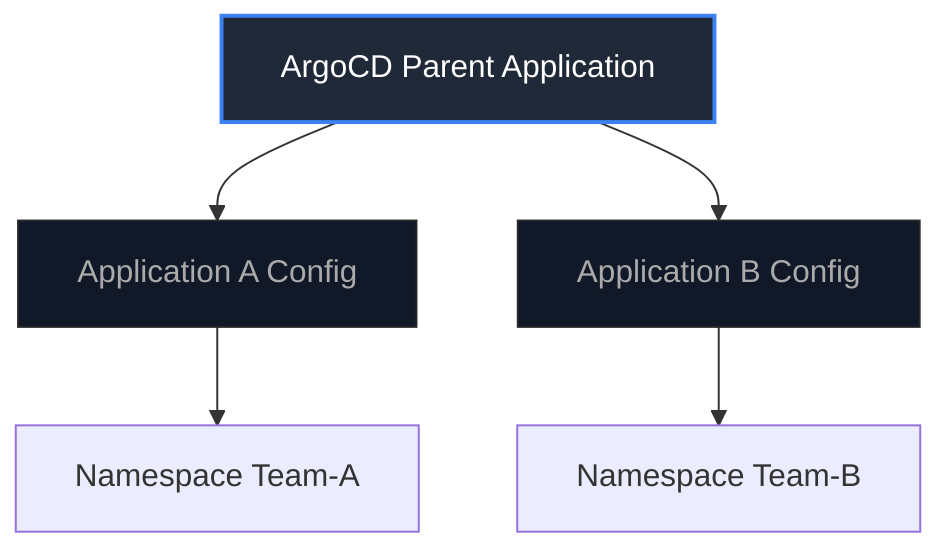

In production Kubernetes environments, SREs (Site Reliability Engineering) strive to minimize toil, increase observability, and eliminate reliability risks associated with changes.

This article comprehensive covers these challenges from an SRE perspective: from leveraging local tools to reduce toil, to surviving GitOps self-healing conflicts during incidents, and designing practical guardrails for multi-tenant architectures.

---

## 1. Reducing Operational Toil through Separation of Concerns

In SRE, repetitive manual actions are defined as "Toil." Reducing toil and lowering cognitive load for developers and operators is a key reliability indicator.

When operating Kubernetes clusters daily, we can minimize toil by explicitly separating **"Control" (change execution) and "Observation" (status monitoring) lifecycles** with the right tools.

### Tool Roles Defined

- **Git**: The single "Source of Truth." Declares the desired state and keeps change histories fully auditable.
- **awsp**: Automates switching AWS profiles/credentials, acting as a safeguard against deploying changes to the wrong cluster.
- **kubectl**: Kept strictly for applying manifests and executing ad-hoc operations.
- **k9s**: A terminal UI (TUI) tool utilized for low-overhead, real-time "Observation" of cluster states and logs.

> [!TIP]
> **Tip for using awsp on Mac (zsh)**
> Since `awsp` switches shell environment variables, running it directly cannot modify the current shell session. On macOS with zsh, add `alias awsp="source _awsp"` to your `~/.zshrc` to make it work correctly. This serves as a vital safeguard against accidental `kubectl apply` commands in staging or production.

### Change Lifecycle Flow

```bash
# 1. Track Desired State in Git
git add pods/pod.yml
git commit -m "add pod manifest"

# 2. Switch Context and Apply
awsp staging
kubectl apply -f pods/pod.yml

# 3. Instantly Observe Actual State
k9s
```

---

## 2. Speeding Up Observation and Lowering MTTR with k9s

During system degradation, SREs prioritize **MTTR (Mean Time To Resolution)**. Reducing MTTR requires rapid debugging and frictionless access to runtime data.

By adopting `k9s`, operators can eliminate the cognitive overhead of copy-pasting Pod names and typing verbose shell commands, expediting incident analysis.

### Checking Status in k9s (Running inside VS Code Terminal)

Keeping k9s running in the integrated terminal reduces context switching between source code and execution logs, allowing SREs to quickly verify status, such as checking if `hello-pod` is in a `Running` status (READY 1/1).


### Core Hotkeys to Minimize MTTR

Use single-key triggers in k9s to investigate issues instantly:

- **l key**: Stream container logs in real time (for rapid logs inspection).
- **s key**: Open a shell inside the container (for checking process states or testing connectivity).
- **ctrl+d**: Instantly delete (restart) a Pod (to mitigate memory leaks or deadlocks under pressure).

---

## 3. The GitOps Reality: Reconciliation vs. Incident Response

GitOps tools like ArgoCD and Flux synchronize the Actual State of a cluster to the Desired State defined in a Git repository.

While this ensures configuration consistency during peace times, **trade-offs surface during active incident response.**

### Self-Healing vs. Manual Mitigation

During severe outages, SREs often need to apply immediate hotfixes—such as temporary scaling, editing environment variables, or disabling sidecars—directly via `kubectl`.

However, if GitOps **self-healing** is enabled, the reconciliation loop will detect this manual deviation and overwrite the SRE's changes back to the broken Git-defined state within seconds or minutes.

This auto-rollback can actively hinder troubleshooting and extend downtime.

> [!WARNING]
> SRE teams must document clear procedures on how to temporarily suspend GitOps auto-sync or reconciliation for specific applications during live incidents.

---

## 4. Architectural Guardrails for Enterprise Reliability

Implementing GitOps using a single shared repository leads to conflicts between platform SREs (managing RBAC, NetworkPolicies, and StorageClasses) and application developers.

To maintain velocity without compromising reliability, SREs must design explicit multi-tenant boundaries.

### Production-Grade Boundary Design

1. **Repository Separation**:
   Isolate core infrastructure configs (DNS, Ingress, RBAC) into a dedicated platform repository, separate from application deployment repositories.
2. **Git CODEOWNERS**:
   Protect platform paths by requiring PR approvals from the platform SRE team before configurations are merged.
3. **App of Apps Pattern (ArgoCD)**:
   A parent Application manages and deploys child Application resources allocated to individual development teams. This confines development permissions strictly to their designated namespace.



### Summary: The SRE Path

- **Maximize Observation Locally**: Use TUI tools like k9s to streamline debugging, minimizing cognitive load and context switching during outages.
- **Layer Your Deployments**: Automate application delivery via GitOps for traceability, but maintain flexibility and control at the platform layer, ensuring SREs have bypass guardrails in place for emergencies.
