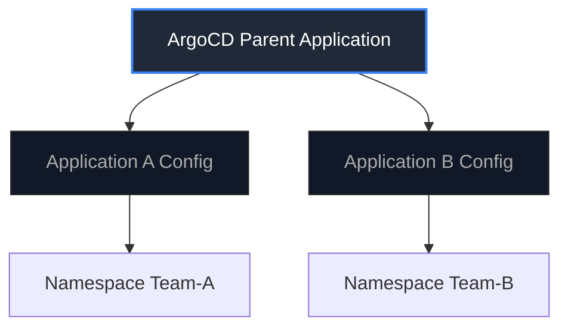

Kubernetes を用いたプロダクション運用の現場において、SRE（Site Reliability Engineering）が目指すのは「トイル（作業的労力）の最小化」「可観測性（Observability）の向上」そして「変更管理に伴う信頼性リスクの排除」です。

本記事では、日常的なデバッグ・運用を加速するローカルツールの使い分けから、GitOps 導入時に直面するインシデントレスポンスの落とし穴、そしてマルチテナント組織における実践的な境界設計まで、SRE の目線から解説します。

---

## 1. 運用トイルを削減するローカルツールの役割分担

SRE において、日常的に繰り返される手動操作は「トイル（Toil）」と定義されます。これをいかに効率化し、開発者や SRE 自身の認知負荷を下げるかが重要です。

クラスター運用の現場では、1つのツールで全てをこなそうとせず、**「変更実行（Control）」と「観測（Observation）」のライフサイクル**に応じてツールを明確に使い分けることでトイルを削減できます。

### ツールの役割定義

- **Git**: 唯一の「真実のソース（Source of Truth）」。すべての望ましい状態を宣言的に記述し、変更履歴を監査可能にする。
- **awsp**: マルチアカウント/マルチ環境における AWS 認証情報の切り替えを自動化し、環境混同による人為的ミスを防ぐ。
- **kubectl**: マニフェストの適用（apply）や、特定のリソースに対するアドホックな実行処理に限定して使用する。
- **k9s**: リアルタイムのリソース監視やログ追跡など、低オーバーヘッドでクラスターの現状を「観測」するために使用する。

> [!TIP]
> **Mac (zsh) で awsp を使う際のヒント**
> `awsp` は、環境変数を変更する仕組み上、単純に実行するだけでは現在のシェルの環境変数を切り替えることができません。Mac の zsh 環境では、`~/.zshrc` に `alias awsp="source _awsp"` を追記してエイリアスを設定してお使いください。これにより、間違ったAWS環境（Staging/Production）への `kubectl apply` を防ぐ安全弁となります。

### 変更適用のライフサイクル

```bash
# 1. 望ましい状態（Desired State）を Git で管理
git add pods/pod.yml
git commit -m "add pod manifest"

# 2. 環境コンテキストを明示的に切り替え、適用
awsp staging
kubectl apply -f pods/pod.yml

# 3. 適用後の状態（Actual State）を即座に観測
k9s
```

---

## 2. k9s による観測の効率化と MTTR の短縮

システムの異常発生時、SRE にとって最も重要なメトリクスの1つが **MTTR（Mean Time To Resolution: 平均復旧時間）** です。MTTR を短縮するには、素早い原因究明とデバッグ環境へのアクセスが求められます。

TUI（Terminal User Interface）ツールである `k9s` を導入することで、コマンドのタイピングや名前のコピペに費やす無駄な時間を排除し、障害時の状況把握を迅速化できます。

### k9s での観測画面（VS Code 統合ターミナルでの表示）

IDE の統合ターミナルで k9s を起動しておくことで、コード変更と実行ログ監視の文脈切り替え（コンテキストスイッチ）を最小限に抑え、トラブル時の状況把握や `hello-pod` が `Running` 状態（READY 1/1）になっていることの確認などを迅速に行うことができます。


### MTTR を下げるためのキー操作

k9s 上でリソースを選択し、ワンキーで必要なデバッグアクションを実行します。

- **l キー**: 瞬時に Pod の標準出力をストリーミング監視（トラブル時のログ解析）。
- **s キー**: 即座にコンテナ内のシェルを起動（プロセス確認やネットワーク疎通確認）。
- **ctrl+d**: 問題のある Pod を即時削除し、再起動（一時的なリソース枯渇やデッドロックへの緊急対処）。

---

## 3. GitOps の現実：インシデントレスポンスにおける自己修復との衝突

ArgoCD や Flux に代表される GitOps は、Git を「唯一の真実のソース」とし、クラスタの実際の状態（Actual State）を Git の定義（Desired State）に自動的に一致（Reconciliation）させる仕組みです。

これは平時の変更管理としては完璧ですが、**「インシデントレスポンス（障害対応）」の局面ではトレードオフが発生します。**

### セルフヒーリングとデバッグの衝突

障害対応の極限状態では、緊急パッチの適用や一時的な構成変更（スケーリング、環境変数の追加、サイドカーの停止など）を `kubectl` で直接実行しなければならない場面があります。

しかし、GitOps の **セルフヒーリング（自己修復機能）** が強力に有効化されていると、SRE が `kubectl` で行った緊急回避操作を検知し、数秒〜数分以内に Git にある古い（しかし壊れているかもしれない）状態へと自動的にロールバック（上書き）してしまいます。

これはデバッグ作業を著しく妨げ、復旧への混乱を招く原因になります。

> [!WARNING]
> SRE は GitOps を導入する際、「自動同期（Auto-Sync）やセルフヒーリングを一時的に一時停止（Suspend）する方法」を事前に手順化しておく必要があります。

---

## 4. 組織の信頼性を担保するプラットフォーム境界設計

GitOps を単一のリポジトリで雑に運用すると、複数のアプリケーション開発チームとプラットフォーム SRE が同一のリポジトリを触ることになり、衝突が発生します。

SRE は、開発速度（Velocity）を落とさずに信頼性（Reliability）を担保するため、境界線を明確にしたマルチテナント設計を行う必要があります。

### 実践的なアーキテクチャ境界

1. **リポジトリの分離**:
   プラットフォームインフラ（NetworkPolicy, RBAC, クラスターアドオン等）を管理するリポジトリと、アプリケーションごとのデプロイリポジトリを明確に分離します。
2. **CODEOWNERS によるガードレール**:
   Git レベルで特定ディレクトリ（例: プラットフォームのネットワーク設定など）に対する変更は、プラットフォーム SRE チームの承認（PR Approve）を必須化します。
3. **App of Apps パターン (ArgoCD)**:
   親となる Application が、開発チームごとに独立した子の Application リソースをデプロイする構造にします。これにより、各開発チームは自身の境界内においてのみ、GitOps による宣言的デプロイの全権限を持つことができます。



### まとめ：SRE 的アプローチ

- **ローカルでは「観測（Observation）」を最大化**：k9s などのツールでトイルとコンテキストスイッチを最小化し、インシデント発生時の認知ロードを下げる。
- **デプロイは「層ごとの使い分け」**：アプリケーション層は GitOps で自動化と監査性を担保する一方、ネットワークやクラスタ基盤といったプラットフォーム層、および緊急対応時のバイパス手段には柔軟性を持たせる設計が、持続可能な信頼性への近道です。
